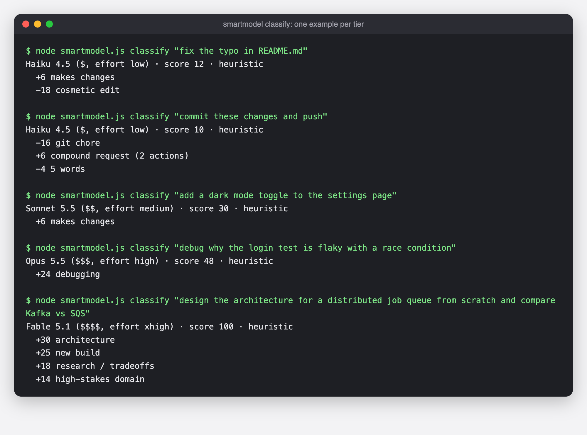
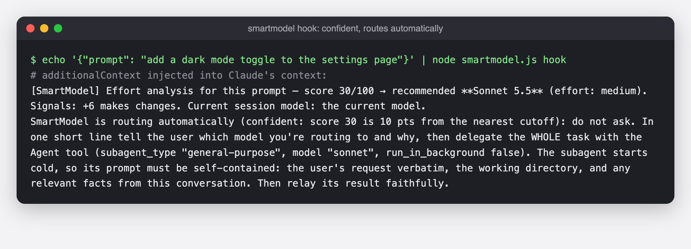
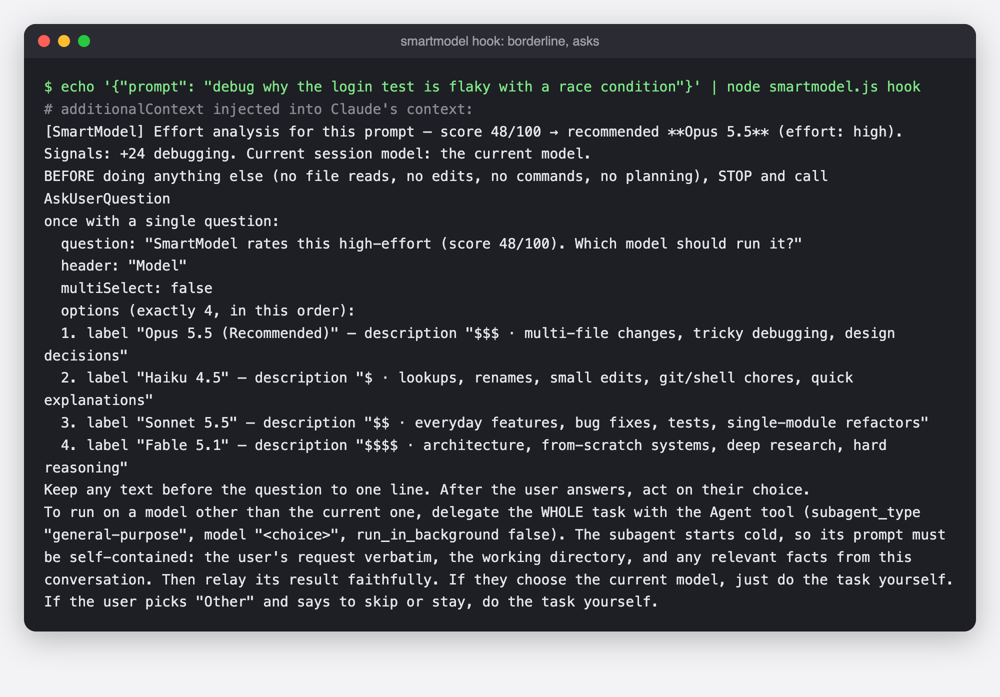
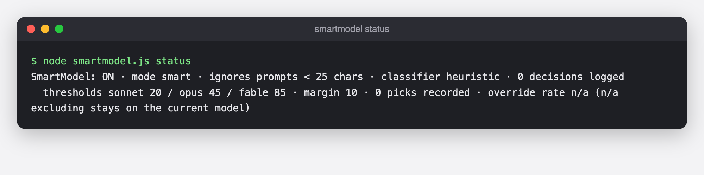
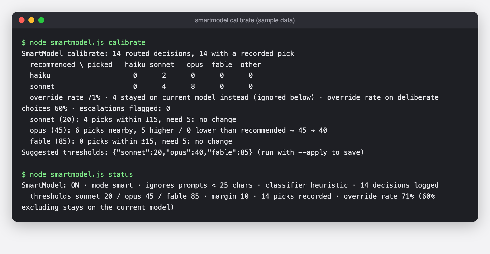

# SmartModel

OpenRouter-style model routing, built into Claude Code.

SmartModel is a small hook for Claude Code. Before Claude acts on your prompt, it scores how much effort the task needs (0 to 100), recommends the cheapest model that should handle it, and either routes the work there or asks you first. It is one dependency-free Node script plus a slash command.

<!-- TODO: picker screenshot (docs/picker.png) -->

## How it works

1. A `UserPromptSubmit` hook runs `smartmodel.js hook` on every prompt.
2. The script scores the prompt with a keyword and structure heuristic (instant, offline). If `ANTHROPIC_API_KEY` is set, a Haiku classifier is used instead, with the heuristic as fallback. The heuristic reads only the first 600 characters with URLs stripped, so a pasted job description or a word inside a link doesn't drive the score. It adds points for multi-step requests ("screenshot it, write the README, then push"), writing work (resumes, cover letters, emails) and links to fetch. Small-task penalties (typo, git, lookup) only apply when there's no bigger work in the same prompt.
3. The score maps to a tier. The hook injects instructions into Claude's context: either "route to this model and say so in one line" or "ask the user which model to use via AskUserQuestion".
4. To run on a model other than the current one, Claude delegates the whole task to a subagent on that model.
5. Every decision is appended to a local `decisions.log`.

## Tiers

Thresholds are defaults, stored in `config.json` as `thresholds: {sonnet, opus, fable}`, and `calibrate` can tune them.

| Score  | Model      | Cost | Effort | Good for |
|--------|------------|------|--------|----------|
| 0 to 19   | Haiku 4.5  | $    | low    | lookups, renames, git chores, quick explanations |
| 20 to 44  | Sonnet 5.5 | $$   | medium | everyday features, bug fixes, tests |
| 45 to 84  | Opus 5.5   | $$$  | high   | multi-file changes, tricky debugging, design |
| 85 to 100 | Fable 5.1  | $$$$ | xhigh  | architecture, from-scratch systems, deep research |

## Modes

Set with `/smartmodel mode <name>`.

- **smart** (default): if the score is at least `margin` points (default 10) from the nearest threshold, it routes automatically and tells you in one line. Closer than that, it asks. A Haiku classifier verdict counts as confident.
- **ask**: Claude always stops and shows a model picker, recommended model first.
- **auto**: routes to the recommended model without asking.
- **block**: the hook rejects the prompt and tells you to `/model <x>` first. Zero tokens are spent on the current model and your context is kept.

## Inline tags

- `sm:skip` leaves this prompt alone.
- `sm:haiku`, `sm:sonnet`, `sm:opus`, `sm:fable` force a model without asking.

## Skip rules

Nothing is injected (and the decision is logged as skipped) when:

- the recommended model is the one you are already on;
- you are mid-task (this session ran a prompt in the last 30 minutes) and the recommendation is cheaper than your current model, since a cold subagent re-reads context the session already has; upgrades still ask. Set `midTaskMinutes` in `config.json` (0 turns it off);
- the prompt is a short conversational question with no imperative verb ("what would a next step be?");
- the message has no task, such as a thanks or acknowledgment;
- the prompt is under 25 characters, a slash command, or a bare "yes" / "go ahead";
- the turn was injected by the harness (subagent hand-backs, system reminders, `!` shell output).

`sm:<model>` tags override the length and conversational skips.

## Learning from picks and calibrate

When a routed decision opens the picker, it gets an id. A `PostToolUse` hook on `AskUserQuestion` runs `smartmodel.js pick` and records which model you chose. `node smartmodel.js calibrate` joins decisions with picks, prints a recommended-versus-picked table, and suggests moving a threshold by 5 points when you consistently pick a higher or lower tier near it (at least 5 samples within 15 points). `calibrate --apply` saves the change.

Each pick is also marked `stayed` when you kept the model you were already on. A stay that disagrees with the recommendation is ambiguous: it can mean "this needs that model" or just "don't switch". So `calibrate` reports those separately and leaves them out when suggesting thresholds.

Pick recording has been confirmed in real Claude Code sessions.

## Install

Requires `node` and `jq`.

```bash
git clone https://github.com/chaekim96/smartmodel.git
cd smartmodel
./install.sh
```

The installer copies the script to `~/.claude/smartmodel/` and the slash command to `~/.claude/commands/`, backs up `~/.claude/settings.json`, and adds the two hook entries using the `node` found on your PATH. It is safe to run twice: it replaces its own entries and leaves your other hooks alone. Restart Claude Code, then run `/smartmodel status`.

## Uninstall

```bash
./uninstall.sh          # removes hooks, script and slash command; keeps config.json and decisions.log
./uninstall.sh --purge  # also deletes ~/.claude/smartmodel
```

## Commands

`/smartmodel on | off | status | mode smart|ask|auto|block | classify <text> | calibrate [--apply]`

## Screenshots

All screenshots are real output of `smartmodel.js`, rendered into a terminal-style image. They use made-up example prompts, not real usage.

**`classify`: scoring example prompts across all four tiers**



**`hook`, confident case: a medium task is routed automatically in smart mode (score 30 is 10 points from the nearest cutoff)**



**`hook`, borderline case: score 48 is 3 points above the Opus cutoff, so smart mode tells Claude to ask with a picker**



**`status`**



**`calibrate`, run on a synthetic sample log (sample data, not real picks)**



## Trade-offs

- **A subagent starts cold.** Routing to another model delegates the task to a subagent that does not see your conversation history. That is fine for self-contained tasks. For a follow-up deep in a long thread, switch with `/model` (or use block mode) to keep the context.
- **The heuristic is only lightly validated.** The weights were re-tuned against about three weeks of one person's real usage. On 49 hand-labeled real prompts, exact tier matches went from 53% to 80%. That set was also used for tuning, so expect less on new prompts. Work that needs Opus still tends to score just under the Opus cutoff, which means smart mode asks rather than routing.
- Routing text is injected as context for Claude to follow, so it is an instruction, not a hard guarantee.

## Privacy

`config.json` and `decisions.log` stay on your machine. `decisions.log` stores the first 120 characters of each routed prompt, so it is git-ignored here.

## License

MIT
